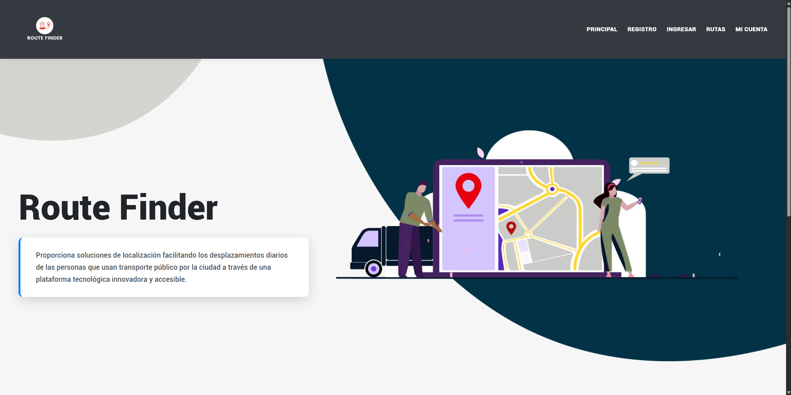
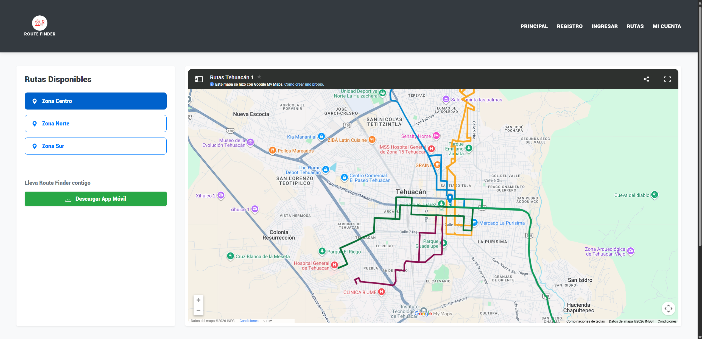

# Routefinder 

Aplicacion web para la busqueda y visualizacion de trayectos del transporte publico para la ciudad de Tehuacan, Puebla, desarrollada con una arquitectura que integra **Node.js**, **PHP** y **MongoDB**, con soporte de **Firebase**.

## Sobre el Proyecto

El objetivo de RouteFinder es ayudar tanto a turistas como residentes que se quieran movilizar por la ciudad de Tehuacán utilizando transporte publico, en RF centralizamos 
más de 20 rutas que operan en la ciudad.
El principal reto que enfrentamos fue el analisis y trasado de cada una de las rutas.

## Características Principales

*  **Autenticación:** Sistema de login y registro de usuarios.
*  **Mapa interactivo:** Mapa interactivo con más de 20 rutas divididas en 3 zonas.
*  **Aplicación movil:** Disponibilidad de una app movil desarrollada para android.

## Tecnologías Utilizadas

### Frontend
* [PHP/ HTML / Bootstrap] - Desarrollo de la interfaz.

### Backend & Base de Datos
* [Node.js / PHP] - Lógica del servidor.
* [Firebase] - Almacenamiento de datos.

## Capturas de Pantalla

## Requisitos Previos

Tener instaladas las siguientes herramientas en el entorno local:

* [Node.js](https://nodejs.org/) (v14 o superior recomendado)
* [PHP](https://www.php.net/) (v7.4 o superior)
* [Composer](https://getcomposer.org/) (Para las dependencias de PHP)

## Instalación y Configuración Local

Si deseas clonar y correr este proyecto en tu entorno local, sigue estos pasos:

1. **Clona el repositorio y ejecuta los siguientes comandos:**
   git clone https://github.com/iSmo0ke/RFinder.git

   npm install
   composer install
   php -S localhost:8000 -t public

Jesús Altamirano Carrillo

* [Portafolio]()

* [LinkedIn](https://www.linkedin.com/in/jac2004/)

* [GitHub](https://github.com/iSmo0ke/)
